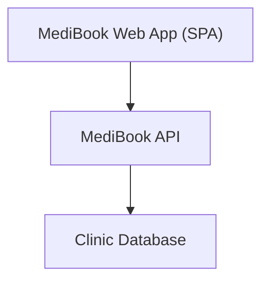
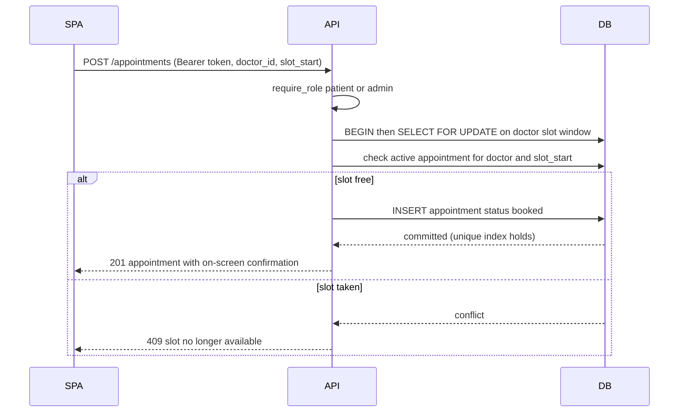
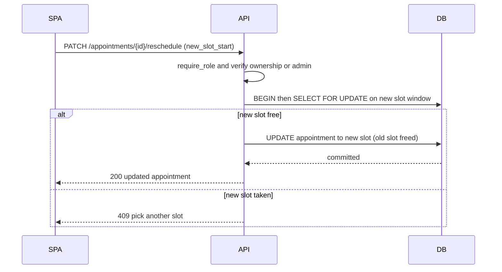
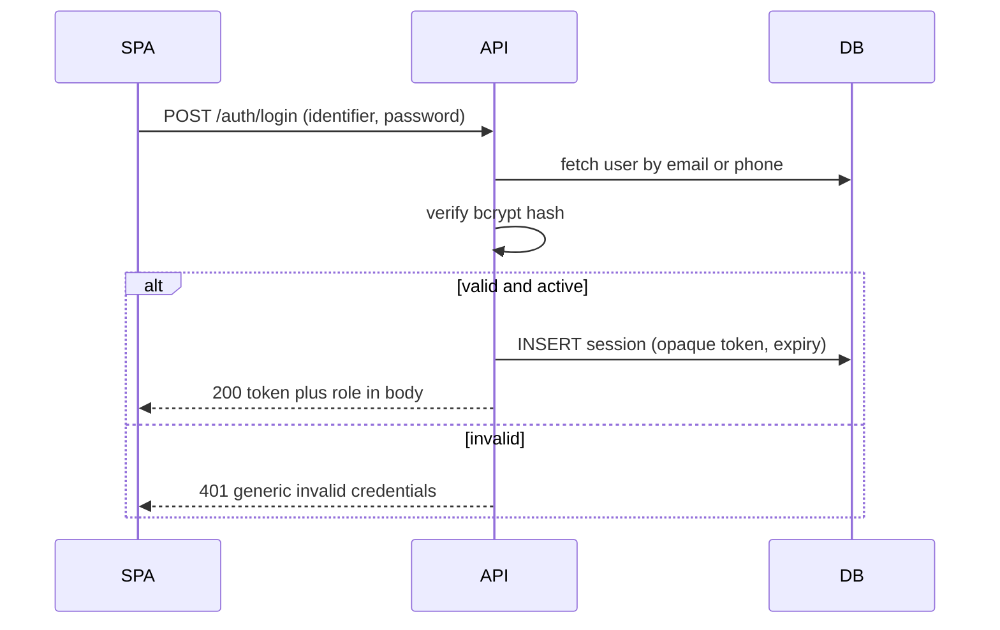
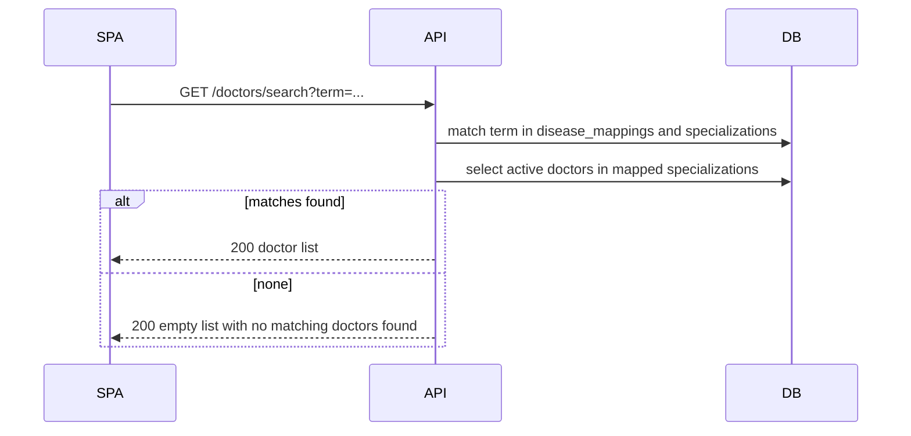
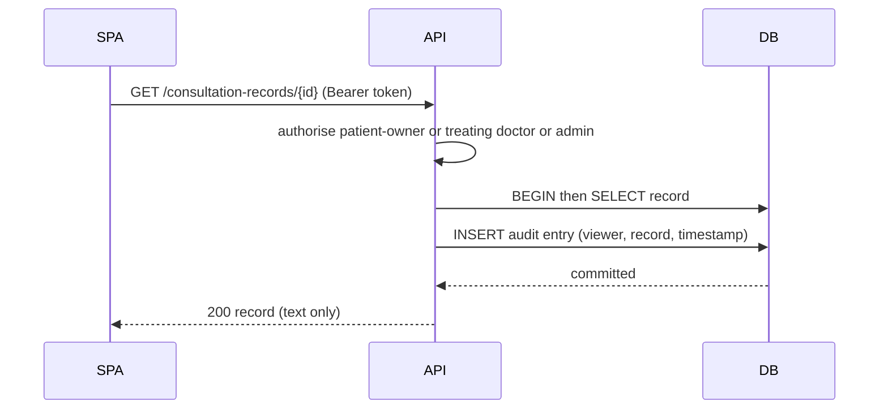
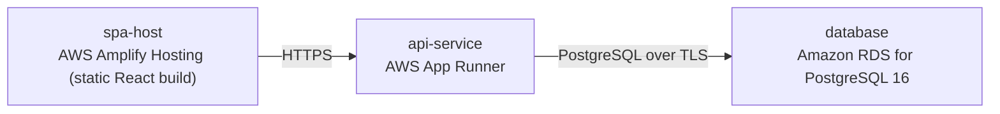

# Architecture

> Maintained by QuorQ AI SDLC. Text between `sdlc:auto` markers is regenerated; anything outside them is yours and is kept.

<!-- sdlc:auto:start narrative -->
## Overview

### ARCH-SUMMARY · approved · source: architecture:summary

MediBook V1 is a single-clinic healthcare appointment platform on React 19 + FastAPI 0.115 + PostgreSQL 16, hosted on AWS in ap-south-1 (Mumbai) to keep health data in-country under India's DPDP Act 2023.

Patients self-register and search for doctors by disease, symptom or specialization through an admin-maintained static lookup (no AI/ML). Doctors set recurring weekly hours and time off, from which the system derives fixed-duration bookable slots, hiding already-booked ones. Booking, reschedule and cancellation are serialised with PostgreSQL transactional row locking plus a partial unique index so a slot can be held by only one appointment. Role-based access (patient, doctor, admin) is enforced on every protected endpoint via opaque server-side session tokens sent as Authorization: Bearer headers. Consultation records are text-only; access and changes are written to an audit trail. All transport is over TLS with encryption at rest on RDS. No payment, email, SMS, file-storage or queue services are designed, as these are out of scope.

### ARCH-COMP-SPA · approved · source: architecture:component:spa

MediBook Web App (SPA) built with React 19 is the single responsive front end used by patients, doctors and admins.

Serves registration, login, doctor search, slot picker, availability calendar, appointment and consultation screens, and the admin dashboard. Stores the opaque session token and sends it as an Authorization: Bearer header on every API call. Reflects availability on page load/refresh only -- there is no live push/real-time update mechanism.

### ARCH-COMP-API · approved · source: architecture:component:api

MediBook API is a FastAPI 0.115 service holding all business logic for the system.

Covers authentication and opaque session management, role-based access enforcement, specialization/doctor/disease-mapping CRUD, disease-to-specialization lookup and doctor search, availability rules and time off, slot generation, transactional appointment booking/reschedule/cancel with double-booking prevention, consultation records, and audit logging of record access and changes.

### ARCH-COMP-DB · approved · source: architecture:component:db

Clinic Database is a PostgreSQL 16 store holding all structured clinic data.

Stores users, sessions, patients, doctors, specializations, disease mappings, availability rules, time off, appointments, consultation records and audit logs. Provides transactional row-level locking and a partial unique index that make double booking impossible, plus encryption at rest for sensitive health data.

### ARCH-CP-BOOKING · approved · source: architecture:critical-path:book-appointment

Booking an appointment is designed to make double-booking impossible via transactional locking plus a partial unique index.

Patient (or admin on behalf) confirms a bookable slot. The API opens a transaction, locks the doctor's slot window, verifies no active appointment exists for that doctor/slot_start, inserts the appointment with status 'booked', and relies on a partial unique index as the final guard. On concurrent attempts for the same slot, one commits and the other receives a 'slot no longer available' error. On success an on-screen confirmation is returned.

### ARCH-CP-RESCHEDULE · approved · source: architecture:critical-path:reschedule

Rescheduling moves an upcoming appointment to a new slot in one transaction, releasing the old slot.

Patient or admin moves an upcoming appointment to a new slot. In one transaction the API locks the target slot window, confirms it is free, updates the appointment to the new slot_start/slot_end, and thereby frees the old slot. If the new slot was just taken, the transaction aborts and the user is asked to pick another slot. Completed or cancelled appointments cannot be rescheduled.

### ARCH-CP-LOGIN · approved · source: architecture:critical-path:login

Login issues an opaque server-side session token rather than a JWT or cookie.

User submits identifier (email or phone) and password. API verifies the salted bcrypt hash, and on success creates a session row with a random opaque token and inactivity/max-lifetime expiry, returning the token in the response body (not a cookie). The SPA stores it and sends it as Authorization: Bearer thereafter. Failed login gives a single generic error without revealing which field was wrong. Logout and admin deactivation revoke the session server-side.

### ARCH-CP-SEARCH · approved · source: architecture:critical-path:disease-search

Doctor search resolves a disease, symptom or specialization term to active doctors via a static, admin-maintained lookup -- no AI/LLM/ML.

Patient enters a disease, symptom or specialization term. The API matches the term against the admin-maintained disease_mappings (and directly against specializations), resolves the mapped specialization set, and returns only active doctors in those specializations. An empty result returns a clear 'no matching doctors found' message.

### ARCH-CP-AUDIT · approved · source: architecture:critical-path:consultation-audit

Consultation record access and changes are role/ownership-scoped and fully audit logged.

A doctor creates/edits a text-only consultation record for one of their appointments, or a patient/admin views a record. Role and ownership are enforced: patient sees only their own, doctor only their treating records. Every view, create and change writes an audit entry (who, which record, when) in the same transaction as the action.

### ARCH-DATA-MODEL · approved · source: architecture:entities

The data model defines 12 tables covering identity/session, clinic structure, scheduling, appointments and auditing.

users(id, name, email, phone, password_hash, role, is_active, created_at); sessions(id, user_id, token, created_at, last_activity_at, expires_at, revoked_at); patients(id, user_id, name, email, phone, created_at); doctors(id, user_id, name, contact_email, contact_phone, slot_duration_minutes, is_active, created_at); specializations(id, name, is_active); doctor_specializations(doctor_id, specialization_id); disease_mappings(id, term, term_type, is_active); disease_mapping_specializations(mapping_id, specialization_id); availability_rules(id, doctor_id, weekday, start_time, end_time); time_off(id, doctor_id, start_at, end_at, reason); appointments(id, doctor_id, patient_id, slot_start, slot_end, status, created_by, created_at, updated_at); consultation_records(id, appointment_id, patient_id, doctor_id, notes, diagnosis, prescription, created_at, updated_at); audit_logs(id, actor_user_id, action, entity_type, entity_id, occurred_at).

### ARCH-API-AUTH · approved · source: architecture:endpoints:auth

Authentication and session endpoints: register, login, logout, current-user profile.

POST /auth/register -- patient self-registration with name and unique email or phone and a password meeting strength rules. POST /auth/login -- authenticate by email/phone and password; returns opaque session token in the body. POST /auth/logout -- revoke the current session server-side. GET /auth/me -- return the current user profile and role.

### ARCH-API-SPECIALIZATIONS · approved · source: architecture:endpoints:specializations

Specialization management endpoints for admins.

GET /specializations -- list specializations (active for selection flows). POST /specializations -- create a specialization with a unique name. PATCH /specializations/{id} -- edit or deactivate a specialization; existing links preserved.

### ARCH-API-DOCTORS · approved · source: architecture:endpoints:doctors

Doctor profile, search and availability endpoints.

POST /doctors -- create a doctor with name, contact and at least one specialization. PATCH /doctors/{id} -- update doctor profile, specializations, or deactivate (removes from search and blocks new slots). GET /doctors/search -- search active doctors by disease, symptom or specialization via the static lookup. PUT /doctors/{id}/availability -- set recurring weekly working hours; overlapping/invalid ranges rejected. POST /doctors/{id}/time-off -- add time off/exception range; warns if it overlaps booked appointments. GET /doctors/{id}/slots -- bookable fixed-duration slots computed from rules minus time off minus booked appointments.

### ARCH-API-DISEASE-MAPPINGS · approved · source: architecture:endpoints:disease-mappings

Admin-maintained disease/symptom-to-specialization lookup endpoints that power search.

GET /disease-mappings -- list disease/symptom-to-specialization mappings. POST /disease-mappings -- map a disease/symptom term to one or more specializations. PATCH /disease-mappings/{id} -- edit or remove a mapping; reflected in subsequent searches.

### ARCH-API-APPOINTMENTS · approved · source: architecture:endpoints:appointments

Appointment lifecycle endpoints: book, list, reschedule, status update, cancel.

POST /appointments -- book an available slot under transactional locking; patient or admin-on-behalf. GET /appointments -- list appointments scoped by role: patient sees own, doctor sees own schedule, admin sees all; supports filters. PATCH /appointments/{id}/reschedule -- move appointment to a new available slot; old slot freed, new locked. PATCH /appointments/{id}/status -- doctor updates status among booked/confirmed/completed/cancelled/no-show; cancel releases slot. DELETE /appointments/{id} -- cancel an upcoming appointment, releasing the slot; completed/cancelled cannot be cancelled.

### ARCH-API-PATIENTS · approved · source: architecture:endpoints:patients

Patient record creation endpoint for front desk/admin use.

POST /patients -- admin/front-desk creates a patient record (no login) with name and email or phone.

### ARCH-API-CONSULTATION-RECORDS · approved · source: architecture:endpoints:consultation-records

Text-only consultation record endpoints with role/ownership-scoped access.

POST /consultation-records -- treating doctor creates a text-only consultation record linked to an appointment; change audited. PATCH /consultation-records/{id} -- edit consultation record text; change captured in audit trail. GET /consultation-records/{id} -- view a record; access audited; patient sees only own, treating doctor and admin permitted. GET /me/consultation-records -- patient lists only their own consultation records.

### ARCH-API-AUDIT-LOGS · approved · source: architecture:endpoints:audit-logs

Admin-only endpoint to review the audit trail for consultation record access and changes.

GET /audit-logs -- admin reviews access and change entries for consultation records.

### ARCH-DEPLOYMENT · approved · source: architecture:deployment-nodes

Three deployment nodes, all within AWS ap-south-1 (Mumbai), one per component.

spa-host: AWS Amplify Hosting serving the React 19 production build as static assets. api-service: AWS App Runner running FastAPI 0.115 on Python via Uvicorn. database: Amazon RDS for PostgreSQL 16 in ap-south-1 (Mumbai).

### ARCH-TECH-FRONTEND · approved · source: architecture:technology:frontend

React 19 was chosen for the single responsive SPA over Vue and Angular.

A single responsive React 19 SPA serves all three roles -- patients on phones, doctors on a daily schedule, admins on a dashboard -- including the interactive slot picker and availability calendar. It stores the opaque session token and sends it as Authorization: Bearer, reading the API base URL from VITE_API_BASE_URL. Alternatives considered: Vue, Angular.

### ARCH-TECH-BACKEND · approved · source: architecture:technology:backend

FastAPI 0.115 was chosen for the API over Django REST Framework and Flask.

FastAPI 0.115 holds the booking logic, generating slots and holding each slot for exactly one appointment via PostgreSQL transactional locking, and its dependency system makes per-request role-based access and audit logging straightforward (US-004, US-024). Alternatives considered: Django REST Framework, Flask.

**Related:** US-004, US-024

### ARCH-TECH-DATABASE · approved · source: architecture:technology:database

PostgreSQL 16 was chosen over MySQL and MariaDB to guarantee no double-booking and to hold structured records and the audit trail.

PostgreSQL 16 makes double-booking impossible through SELECT FOR UPDATE plus a partial unique index on active appointments, stores all structured clinic records, supports encryption at rest, and holds the audit trail (US-013, US-023, US-024). Term matching for disease/specialization search runs inside PostgreSQL, so no separate search service is added. Alternatives considered: MySQL, MariaDB.

**Related:** US-013, US-023, US-024

### ARCH-TECH-CLOUD · approved · source: architecture:technology:cloud

AWS, specifically ap-south-1 (Mumbai), was chosen over Azure and GCP to keep health data in-country under India's DPDP Act.

AWS runs the ap-south-1 (Mumbai) region, keeping the database, application and all health data in India to satisfy the DPDP Act's no-cross-border rule, and provides managed PostgreSQL (RDS), encryption at rest via KMS, and audit-friendly logging off the shelf (NFR-007, NFR-008). Alternatives considered: Azure, GCP.

**Related:** NFR-007, NFR-008
<!-- sdlc:auto:end narrative -->

<!-- sdlc:auto:start building-blocks -->
## Building Block View

| ID | Name | Technology | Responsibility | Depends on |
|---|---|---|---|---|
| spa | MediBook Web App (SPA) | React 19 | Responsive single-page app for patients, doctors and admins: registration, login, doctor search, slot picker, availability calendar, appointment and consultation screens, and the admin dashboard. Stores the opaque session token and sends it as Authorization: Bearer on every API call. Reflects availability on page load/refresh (no live push). | api |
| api | MediBook API | FastAPI 0.115 | FastAPI service holding all business logic: authentication and opaque session management, role-based access enforcement, specialization/doctor/disease-mapping CRUD, disease-to-specialization lookup and doctor search, availability rules and time off, slot generation, transactional appointment booking/reschedule/cancel with double-booking prevention, consultation records, and audit logging of record access and changes. | db |
| db | Clinic Database | PostgreSQL 16 | PostgreSQL store for users, sessions, patients, doctors, specializations, disease mappings, availability rules, time off, appointments, consultation records and audit logs. Provides transactional row-level locking and a partial unique index that make double booking impossible, and encryption at rest for sensitive health data. | — |

<!-- sdlc:auto:end building-blocks -->

<!-- sdlc:auto:start runtime -->
## Runtime View

### Book an appointment with double-booking prevention

Patient (or admin on behalf) confirms a bookable slot. The API opens a transaction, locks the doctor's slot window, verifies no active appointment exists for that doctor/slot_start, inserts the appointment with status 'booked', and relies on a partial unique index as the final guard. Concurrent attempts on the same slot: one commits, the other receives a 'slot no longer available' error. On success an audit-independent on-screen confirmation is returned.

- **Components:** spa, api, db
- **Modules:** appointments.service, appointments.router, slots.service, auth.dependencies
- **Key functions:** generate_slots(doctor_id, date_range), book_appointment(patient_id, doctor_id, slot_start), lock_slot_for_update(doctor_id, slot_start), require_role(roles)

### Reschedule appointment (release old slot, take new)

Patient or admin moves an upcoming appointment to a new slot. In one transaction the API locks the target slot window, confirms it is free, updates the appointment to the new slot_start/slot_end, and thereby frees the old slot. If the new slot was just taken, the transaction aborts and the user is asked to pick another slot. Completed or cancelled appointments cannot be rescheduled.

- **Components:** spa, api, db
- **Modules:** appointments.service, appointments.router
- **Key functions:** reschedule_appointment(appointment_id, new_slot_start), lock_slot_for_update(doctor_id, slot_start), assert_reschedulable(appointment)

### Login and opaque session issuance

User submits identifier (email or phone) and password. API verifies the salted bcrypt hash, and on success creates a session row with a random opaque token and inactivity/max-lifetime expiry, returning the token in the response body (not a cookie). The SPA stores it and sends it as Authorization: Bearer thereafter. Failed login gives a single generic error without revealing which field was wrong. Logout and admin deactivation revoke the session server-side.

- **Components:** spa, api, db
- **Modules:** auth.service, auth.router, auth.dependencies, sessions.service
- **Key functions:** authenticate(identifier, password), verify_password(password, hash), create_session(user_id), revoke_session(token), get_current_user(token)

### Disease/symptom search via static lookup

Patient enters a disease, symptom or specialization term. The API matches the term against the admin-maintained disease_mappings (and directly against specializations), resolves the mapped specialization set, and returns only active doctors in those specializations. No AI/LLM/ML is involved. An empty result returns a clear 'no matching doctors found' message.

- **Components:** spa, api, db
- **Modules:** search.service, search.router, mappings.service
- **Key functions:** resolve_specializations(term), search_active_doctors(specialization_ids)

### Consultation record access with audit logging

A doctor creates/edits a text-only consultation record for one of their appointments, or a patient/admin views a record. Role and ownership are enforced (patient sees only their own, doctor only their treating records). Every view, create and change writes an audit entry (who, which record, when) in the same transaction as the action.

- **Components:** spa, api, db
- **Modules:** records.service, records.router, audit.service, auth.dependencies
- **Key functions:** create_record(appointment_id, notes, diagnosis, prescription), update_record(record_id, fields), get_record(record_id, current_user), write_audit(user_id, action, record_id)

<!-- sdlc:auto:end runtime -->

<!-- sdlc:auto:start deployment-view -->
## Deployment View

| Name | Service | Runtime | Scaling | Environment |
|---|---|---|---|---|
| spa-host | AWS Amplify Hosting (static React build) | React 19 production build served as static assets | CDN-fronted static hosting, single environment | dev |
| api-service | AWS App Runner | FastAPI 0.115 on Python (Uvicorn) | Single small instance for a single clinic, auto-restart | dev |
| database | Amazon RDS for PostgreSQL 16 | PostgreSQL 16 in ap-south-1 (Mumbai) | Single instance, encryption at rest via KMS, automated backups | dev |

| Source | Target | Protocol |
|---|---|---|
| spa-host | api-service | HTTPS |
| api-service | database | PostgreSQL over TLS |

<!-- sdlc:auto:end deployment-view -->

<!-- sdlc:auto:start decisions -->
## Architecture Decisions

| Layer | Choice | ADR |
|---|---|---|
| Frontend | React 19 | [ADR-0001](adr/frontend.md) |
| Backend | FastAPI 0.115 | [ADR-0002](adr/backend.md) |
| Database | PostgreSQL 16 | [ADR-0003](adr/database.md) |
| Cloud | AWS | [ADR-0004](adr/cloud.md) |
<!-- sdlc:auto:end decisions -->

<!-- sdlc:auto:start links -->
## Related Documents

- [Data Model](data-model.md)
- [API Specification](api/openapi.yaml)
- [Architecture Decision Records](adr/README.md)
<!-- sdlc:auto:end links -->
