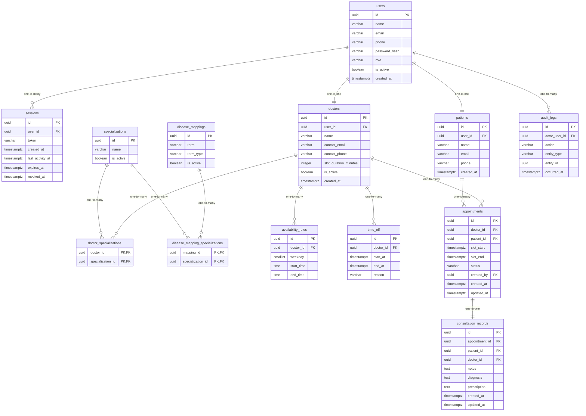

# Data Model

<!-- sdlc:auto:start entities -->
### users

| Field | Type | PK | FK | Nullable |
|---|---|---|---|---|
| id | uuid | True | — | False |
| name | varchar | False | — | False |
| email | varchar | False | — | True |
| phone | varchar | False | — | True |
| password_hash | varchar | False | — | False |
| role | varchar | False | — | False |
| is_active | boolean | False | — | False |
| created_at | timestamptz | False | — | False |

### sessions

| Field | Type | PK | FK | Nullable |
|---|---|---|---|---|
| id | uuid | True | — | False |
| user_id | uuid | False | users.id | False |
| token | varchar | False | — | False |
| created_at | timestamptz | False | — | False |
| last_activity_at | timestamptz | False | — | False |
| expires_at | timestamptz | False | — | False |
| revoked_at | timestamptz | False | — | True |

### patients

| Field | Type | PK | FK | Nullable |
|---|---|---|---|---|
| id | uuid | True | — | False |
| user_id | uuid | False | users.id | True |
| name | varchar | False | — | False |
| email | varchar | False | — | True |
| phone | varchar | False | — | True |
| created_at | timestamptz | False | — | False |

### doctors

| Field | Type | PK | FK | Nullable |
|---|---|---|---|---|
| id | uuid | True | — | False |
| user_id | uuid | False | users.id | True |
| name | varchar | False | — | False |
| contact_email | varchar | False | — | True |
| contact_phone | varchar | False | — | True |
| slot_duration_minutes | integer | False | — | False |
| is_active | boolean | False | — | False |
| created_at | timestamptz | False | — | False |

### specializations

| Field | Type | PK | FK | Nullable |
|---|---|---|---|---|
| id | uuid | True | — | False |
| name | varchar | False | — | False |
| is_active | boolean | False | — | False |

### doctor_specializations

| Field | Type | PK | FK | Nullable |
|---|---|---|---|---|
| doctor_id | uuid | True | doctors.id | False |
| specialization_id | uuid | True | specializations.id | False |

### disease_mappings

| Field | Type | PK | FK | Nullable |
|---|---|---|---|---|
| id | uuid | True | — | False |
| term | varchar | False | — | False |
| term_type | varchar | False | — | False |
| is_active | boolean | False | — | False |

### disease_mapping_specializations

| Field | Type | PK | FK | Nullable |
|---|---|---|---|---|
| mapping_id | uuid | True | disease_mappings.id | False |
| specialization_id | uuid | True | specializations.id | False |

### availability_rules

| Field | Type | PK | FK | Nullable |
|---|---|---|---|---|
| id | uuid | True | — | False |
| doctor_id | uuid | False | doctors.id | False |
| weekday | smallint | False | — | False |
| start_time | time | False | — | False |
| end_time | time | False | — | False |

### time_off

| Field | Type | PK | FK | Nullable |
|---|---|---|---|---|
| id | uuid | True | — | False |
| doctor_id | uuid | False | doctors.id | False |
| start_at | timestamptz | False | — | False |
| end_at | timestamptz | False | — | False |
| reason | varchar | False | — | True |

### appointments

| Field | Type | PK | FK | Nullable |
|---|---|---|---|---|
| id | uuid | True | — | False |
| doctor_id | uuid | False | doctors.id | False |
| patient_id | uuid | False | patients.id | False |
| slot_start | timestamptz | False | — | False |
| slot_end | timestamptz | False | — | False |
| status | varchar | False | — | False |
| created_by | uuid | False | users.id | True |
| created_at | timestamptz | False | — | False |
| updated_at | timestamptz | False | — | False |

### consultation_records

| Field | Type | PK | FK | Nullable |
|---|---|---|---|---|
| id | uuid | True | — | False |
| appointment_id | uuid | False | appointments.id | False |
| patient_id | uuid | False | patients.id | False |
| doctor_id | uuid | False | doctors.id | False |
| notes | text | False | — | True |
| diagnosis | text | False | — | True |
| prescription | text | False | — | True |
| created_at | timestamptz | False | — | False |
| updated_at | timestamptz | False | — | False |

### audit_logs

| Field | Type | PK | FK | Nullable |
|---|---|---|---|---|
| id | uuid | True | — | False |
| actor_user_id | uuid | False | users.id | True |
| action | varchar | False | — | False |
| entity_type | varchar | False | — | False |
| entity_id | uuid | False | — | True |
| occurred_at | timestamptz | False | — | False |
<!-- sdlc:auto:end entities -->

<!-- sdlc:auto:start relationships -->
| Source | Target | Type |
|---|---|---|
| users | sessions | one-to-many |
| users | patients | one-to-one |
| users | doctors | one-to-one |
| doctors | doctor_specializations | one-to-many |
| specializations | doctor_specializations | one-to-many |
| disease_mappings | disease_mapping_specializations | one-to-many |
| specializations | disease_mapping_specializations | one-to-many |
| doctors | availability_rules | one-to-many |
| doctors | time_off | one-to-many |
| doctors | appointments | one-to-many |
| patients | appointments | one-to-many |
| appointments | consultation_records | one-to-one |
| users | audit_logs | one-to-many |
<!-- sdlc:auto:end relationships -->

<!-- sdlc:auto:start er-diagram -->

<!-- sdlc:auto:end er-diagram -->
