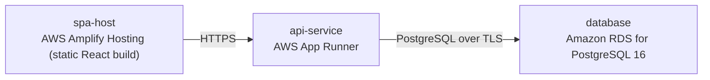

# Deployment Guide

> Maintained by QuorQ AI SDLC. Text between `sdlc:auto` markers is regenerated; anything outside them is yours and is kept.

<!-- sdlc:auto:start how-it-deploys -->
Pushes to `main` run `.github/workflows/deploy.yml`, which builds the API image (if there is a backend) and deploys the SPA to AWS Amplify. Commits touching only `docs/sdlc/**` don't deploy. Deployments can also be started from the platform's Deployment tab.
<!-- sdlc:auto:end how-it-deploys -->

<!-- sdlc:auto:start environments -->
| Name | Service | Runtime | Scaling | Environment |
|---|---|---|---|---|
| spa-host | AWS Amplify Hosting (static React build) | React 19 production build served as static assets | CDN-fronted static hosting, single environment | dev |
| api-service | AWS App Runner | FastAPI 0.115 on Python (Uvicorn) | Single small instance for a single clinic, auto-restart | dev |
| database | Amazon RDS for PostgreSQL 16 | PostgreSQL 16 in ap-south-1 (Mumbai) | Single instance, encryption at rest via KMS, automated backups | dev |
<!-- sdlc:auto:end environments -->

<!-- sdlc:auto:start live -->
_Not deployed yet._
<!-- sdlc:auto:end live -->

<!-- sdlc:auto:start topology -->

<!-- sdlc:auto:end topology -->
